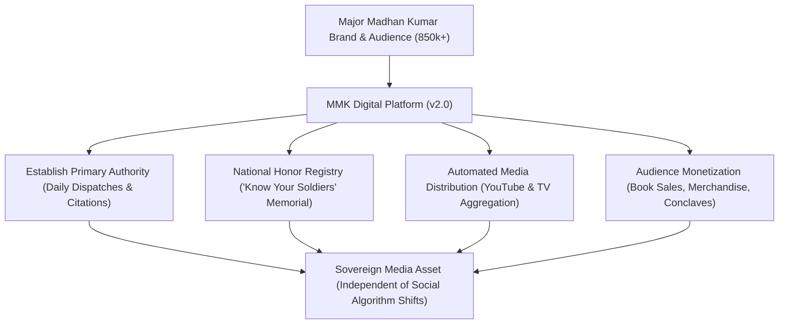

# Major Madhan Kumar (MMK) Digital Platform
## Executive Showcase & Comprehensive Feature Walkthrough

---

### Executive Overview: The Digital Command Center

The **Major Madhan Kumar (MMK) Digital Platform** is a bespoke personal authority, news, and media ecosystem built specifically for **Major Madhan Kumar (Retd)**. 

Moving beyond third-party social media algorithms, this platform gives Major Madhan Kumar a **sovereign digital home** designed to:
1. **Solidify Primary Geopolitical Authority:** Position Major Madhan Kumar as India’s foremost voice on national security, regional strategy, and defense literacy.
2. **Deliver Daily High-Impact Intelligence:** Provide a fast, flowing news feed rivaling major international publications (*Firstpost, Foreign Policy, Jane's Defence*).
3. **Honor the Armed Forces:** House India’s most respectful digital tribute portal—the *"Know Your Soldiers"* archive.
4. **Monetize & Scale the Brand:** Seamlessly drive revenue through book sales (*Operation Sindoor*), documentary viewership (*Making The Unbreakable*), official merchandise, and paid speaking conclaves.
5. **Provide 100% Code-Free Management:** Allow Major Madhan Kumar and his media team to update articles, upload photos, and change settings without needing software developers.

---

### 1. The Homepage: Firstpost-Style Media Hub

The homepage commands immediate attention with an editorial layout that feels authoritative, urgent, and clean.


#### Key Capabilities:
- **Real-Time Breaking News Ticker:** A top scrolling banner highlighting urgent geopolitical alerts and tactical intercepts.
- **Spotlight Analysis Hero:** Dominant front-page placement for Major Madhan Kumar's primary analysis of the day, complete with category badges, author attribution, and publication timestamps.
- **Trending Strategic Topics:** Quick-filter pills (`#BorderSecurity`, `#OSINT`, `#NavalWarfare`, `#CareerGuidance`) allowing readers to dive into topics in a single tap.
- **Social Proof Metric Counter:** Prominently communicates Major Madhan Kumar’s reach (850,000+ followers across YouTube, Instagram, and digital channels) to immediately establish credibility with new visitors, journalists, and event organizers.

---

### 2. Strategic Promotions: Books, Documentaries & Gear

Positioned prominently alongside the news feed are dedicated conversion cards that turn reader attention into active engagement and revenue.


#### Key Capabilities:
- **Operation Sindoor Book Card:** Dedicated showcase for Major Madhan Kumar’s bestseller. Includes book cover artwork, format options (*Hardcover, Kindle, Audiobook*), and a 1-click external purchase button with affiliate disclosure.
- **Making The Unbreakable Documentary Card:** Features trailer artwork, episode runtimes, and a direct streaming redirect to YouTube.
- **Official MMK Store Spotlight:** Displays featured tactical gear (such as the Official Tactical Commando Cap) with live INR pricing and direct routing to the store.
- **Subscriber Exclusive Badges:** Distinct visual ribbons highlighting deep-dive analysis reserved for dedicated community members.

---

### 3. Geopolitical Analysis & News Hub

The `/articles` section houses Major Madhan Kumar's complete written archive, categorized for fast discovery.


#### Key Capabilities:
- **Instant Keyword Search:** Readers can type keywords or topic titles to filter the entire article archive instantly.
- **Topic Filters:** One-click filtering across *Geopolitics, Defense, OSINT (Open Source Intelligence), Blog Feed,* and *Career Guidance*.
- **Language Edition Switcher:** Pre-configured architecture supporting multilingual releases (English, Hindi, Tamil) as the platform expands.
- **Reading Time & Metadata Indicators:** Readers can see estimated reading times and publication dates upfront.

---

### 4. Distraction-Free Article Reading Experience

When a reader clicks into an article, the interface transitions into a high-legibility, publication-grade reading environment.


#### Key Capabilities:
- **Reader Mode Layout:** Generous typography, high contrast, and zero cluttered popups ensure long-form analysis is enjoyable to read.
- **1-Click Print & PDF Citation Button:** Academics, defense researchers, and journalists can download or print verified citations of Major Madhan Kumar’s work with a single click.
- **Source Citations & Reference Lists:** Footnotes and source links are cleanly formatted to reinforce analytical rigor and trust.

---

### 5. "Know Your Soldiers" Armed Forces Memorial

One of the platform's defining features is the dedicated tribute portal honoring living veterans and fallen martyrs of the Indian Armed Forces.


#### Key Capabilities:
- **Multi-Filter Search Engine:** Search across thousands of records by soldier name, military unit, home state, or medal.
- **Category Segmentation:** Quick tabs to switch between *All Heroes, Veer Gatha (Martyrs),* and *Living Veterans*.
- **Branch-Specific Filters:** Filter by *Indian Army, Indian Navy, Indian Air Force,* and *Para Special Forces (Para SF)*.
- **Rank Filters:** Filter by rank from *Naik* and *Subedar Major* up to *Captain, Major,* and *Brigadier*.
- **Gallantry Award Badges:** Visual ribbons highlighting recipients of the *Param Vir Chakra (PVC), Ashoka Chakra, Vir Chakra,* and *Sena Medal*.

---

### 6. Soldier Tribute Profile (Veer Gatha Hero)

Each soldier has an individual, shareable profile commemorating their life, military career, and bravery.


#### Key Capabilities:
- **Distinctive Veer Gatha Borders:** Red and gold visual framing honoring martyrs who made the supreme sacrifice.
- **Official Military Dossier:** Unit/Regiment (e.g. *13 JAK RIF*), Home State, Service Timeline, and Decorations.
- **Inspirational Citations:** Prominently features the officer's motto and battle cry (e.g., *"Yeh Dil Maange More!"*).
- **Comprehensive Biography:** Detailed records of tactical operations (e.g., *Operation Vijay, Battle of Point 5140 and Point 4875*).
- **Printable Memorial Citation:** A single-click print button formatted for school libraries, educational seminars, and family tributes.

---

### 7. Automated Multimedia & Video Library

The `/videos` hub aggregates Major Madhan Kumar’s TV debates, podcast appearances, and YouTube analyses into a responsive broadcast center.


#### Key Capabilities:
- **Zero-Effort Video Sync:** Simply entering a YouTube video link or ID automatically pulls the video thumbnail, title, view count, and category—no video files ever need to be manually uploaded.
- **Responsive 3-Column Video Showcase:** Clean grid with thumbnail previews, play buttons, and topic pills.
- **Categorized Playlists:** Filter videos by *Geopolitics, Defense Analysis, SSB Career Guidance,* and *Motivational Keynotes*.

---

### 8. Official Merchandise Store

A fully branded storefront allowing followers to purchase official MMK tactical gear, apparel, and memorabilia.


#### Key Capabilities:
- **Curated Tactical Product Grid:** Displays product photos, detailed specifications, and prices in Indian Rupees (₹ INR).
- **Smart Inventory & Stock Badges:** Automatic "OUT OF STOCK" badges prevent customer confusion when an item sells out.
- **Flexible Checkout Direct Links:** Items can link directly to external stores (Amazon India, Shopify, or brand partners), and the platform is prepared for future native in-cart checkout.
- **Diverse Catalog Support:** Supports tactical apparel (*Siachen Commando Hoodie, Military Olive Field Tee*), accessories (*Tactical Admin EDC Pouch, Commando Cap*), and collectible challenge coins.

---

### 9. Strategic Conclaves & Event Calendar

The `/events` portal manages Major Madhan Kumar’s public speaking engagements, defense summits, and masterclasses.


#### Key Capabilities:
- **Chronological Event Tracking:** Automatically categorizes events into *Upcoming Events, Past Events,* and *All Initiatives*.
- **Real-Time Registration Badges:** Shows whether delegate applications are "OPEN" (in green) or "CLOSED".
- **Complete Venue & Schedule Dossier:** Displays event dates, times, and venue locations (e.g., *Manekshaw Centre Auditorium, New Delhi*).
- **Direct Application Routing:** "JOIN PANEL" buttons route attendees directly to registration portals or ticketing partners.

---

### 10. Photo Gallery & Field Archives

The `/gallery` section provides an official photo album of military inspections, international conferences, and book launches.


#### Key Capabilities:
- **Event-Based Photo Albums:** Grouped by occasion (*High-Altitude Northern Border Inspections, NDA Passing Out Parade, Raisina Dialogue Sessions*).
- **Interactive Lightbox Experience:** Readers can click any photograph to view it in full-screen high resolution with captions.
- **Instant Photo Loading:** Images are served through modern WebP image compression, ensuring fast loading on mobile data.

---

### 11. Profile & Authority Hub: About Major Madhan Kumar

A dedicated personal branding page presenting Major Madhan Kumar’s military career, public service, and media credentials.


#### Key Capabilities:
- **Executive Biography:** Details nearly three decades spanning the Indian Army, corporate leadership, and geopolitical strategic advisory.
- **Career Milestones:** Documented command roles in counter-insurgency and high-altitude operational logistics.
- **Quick-Navigation Pathways:** Direct buttons linking readers to *Read Strategic Analysis*, the *Honor List Database*, or *Speaking Inquiries*.
- **Downloadable Press Kit:** Provides conference organizers and TV debate producers with official bio summaries, high-resolution headshots, and topic portfolios.

---

### 12. Strategic Communications & Speaking Desk

A centralized inquiry portal that routes professional requests directly to Major Madhan Kumar’s management team.


#### Key Capabilities:
- **Departmental Routing:** Clearly separates contacts for:
  - *Keynote & Speaking Engagements* (`speaking@majormadhankumar.com`)
  - *Press, Television & Media Interviews* (`media@majormadhankumar.com`)
  - *Defense Advisory & Strategic Research* (`advisory@majormadhankumar.com`)
- **Structured Lead Capture Form:** Requisition form captures full name, organization, inquiry category, event date, and audience size.
- **Spam Protection & Notification:** Automatically validates submissions and securely notifies the team without exposing private mailboxes to spam bots.

---

### 13. The Admin Command Center: Total Code-Free Control

Major Madhan Kumar and his editorial staff have complete, password-protected ownership of the entire website through an intuitive control room.


#### What the Client Can Control (Without Touching Code):
| Area | Client Capabilities |
| :--- | :--- |
| **Articles & News** | Draft, publish, schedule, or update strategic analyses and set breaking news alerts. |
| **Soldier Profiles** | Add newly honored veterans or martyrs, upload military portraits, and update citations. |
| **Merchandise Store** | Add new t-shirts, caps, or books, update INR prices, and toggle out-of-stock badges. |
| **Events & Conclaves** | Add speaking dates, set venue addresses, and toggle registration open/closed. |
| **YouTube Sync** | Simply paste a video link or hit the "Sync YouTube Channel" button to refresh the video feed. |
| **Site Settings** | Update social media follower counts, contact emails, and homepage banners directly from one screen. |

---

### 14. Reader Comfort: Seamless Dark & Light Modes

Readers can switch between deep military navy/black and a clean, high-contrast light mode with a single click.

````carousel

<!-- slide -->

````

- **Tactical Dark Mode:** Ideal for evening readers, military personnel, and desktop research.
- **High-Contrast Light Mode:** Crisp white paper background with deep dark text for daytime reading in bright outdoor sunlight.

---

### 15. Flawless Experience on Mobile Devices

Over 75% of Major Madhan Kumar's audience visits via mobile smartphones. The entire platform has been custom-tuned for smartphones.


#### Mobile Highlights:
- **Compact Top Bar:** Branded crest, mobile drawer menu, and quick store cart icon.
- **Touch-Optimized Filters:** Smooth finger-friendly topic pills.
- **Rapid Loading:** High-efficiency modern image formatting (WebP) ensures pages load in under 1 second, even on mobile network connections.

---

### Summary: Why This Platform is a High-Value Investment



1. **Digital Sovereignty:** Major Madhan Kumar is no longer dependent on social media algorithms; he owns an institutional media asset.
2. **Editorial Speed:** The client’s team can publish breaking defense news within seconds of an international event occurring.
3. **National Impact:** The "Know Your Soldiers" tribute is a first among Indian defense platforms, building immense goodwill and community pride.
4. **Direct Revenue:** Direct channel to sell thousands of copies of *Operation Sindoor*, fill conference seats, and sell branded apparel directly to an engaged patriotic following.
